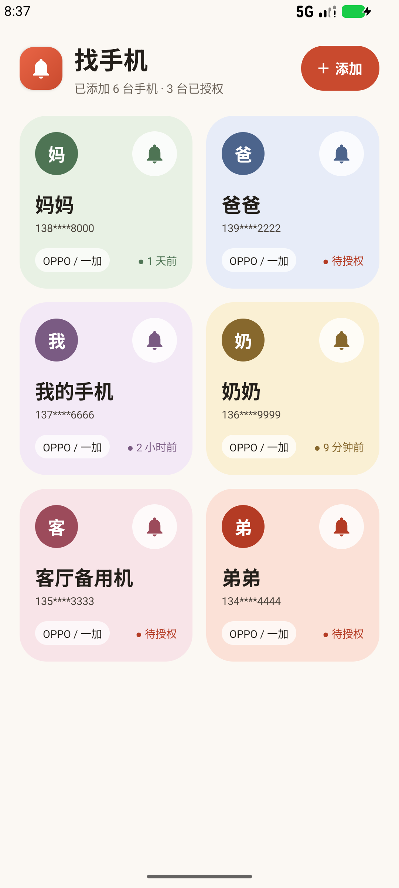
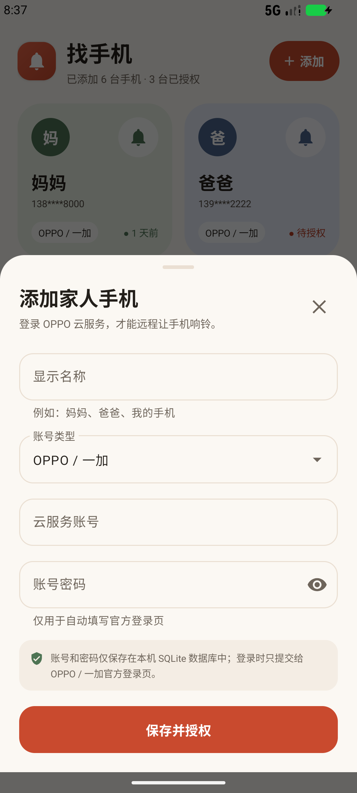
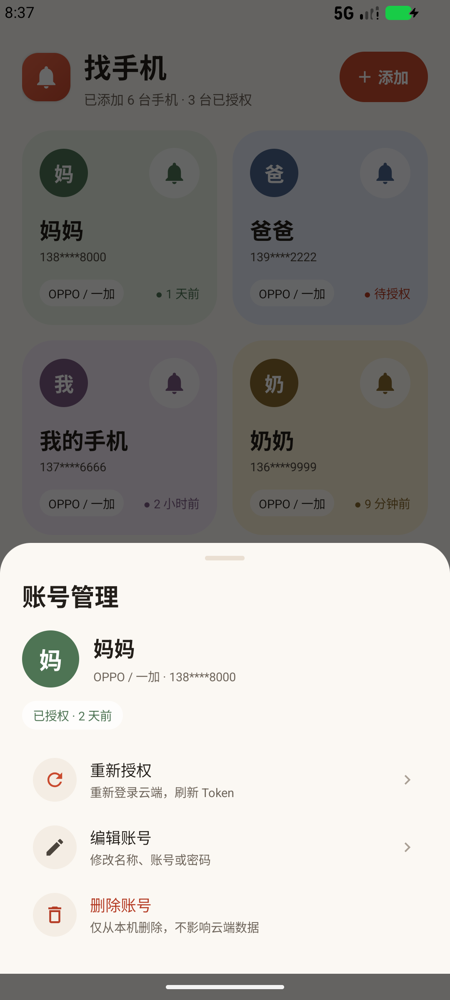

# 找手机

一个专门用来让家里的 OPPO / 一加手机响铃的小应用。手机随手丢在家里找不到时，打开它，点一下对应成员卡片上的铃铛，手机就会通过 OPPO 云服务响起来。

整个应用只有一个 Activity：账号列表就是首页，添加账号、账号管理、登录授权都以底部弹层或全屏浮层呈现。

### 项目介绍【头条】：https://www.toutiao.com/article/7700779272480588322
## 功能

- 本地 SQLite 保存家人账号，只有一张 `accounts` 表。
- 添加 / 编辑 / 删除账号，账号类型为下拉框（当前只有 `OPPO / 一加` 一项）。
- 首页两列卡片，每张卡片对应一个家人账号，带按压缩放和涟漪点击效果。
- 卡片右上角是铃铛按钮：
  - 已授权：直接向云端发送响铃指令。
  - 未授权：先完成官方云服务登录，再自动继续响铃。
  - 账号下有多台设备时，会先弹出设备选择。
  - 云端确认发送成功后，铃铛会左右晃动约 3 秒。
- 登录页会尝试自动填入账号密码，并模拟点击 Cookie、登录账号和协议；如果真机上自动点击没有跳转，可以手动完成登录后点底部「完成」兜底。
- 登录使用 `cloud.oppo.com` 官方网页登录页，账号密码自动填入；遇到滑块、短信或账号升级验证时可以在应用内完成。
- 登录完成后保存云服务 Cookie 和 `TOKENKEY`，并记录获取时间。
- 卡片上的状态会显示「待授权」或距离上次授权的相对时间；时间显示为 `25分 / 3小时 / 2天 / 10月18日`，每分钟只刷新可见卡片文字，不重读数据库、不联网。
- 首页底部显示当前版本号，例如 `v1.9`；顶部 header 使用独立底色，并在接缝处加了向下渐变的阴影。
- 账号管理里的「重新授权 / 编辑账号 / 删除账号」和设备选择项，每项都是独立的小圆角卡片。
- 支持跟随系统的浅色 / 深色模式：深色下使用暖黑背景、低饱和卡片和适合暗色的文字/图标。

## 截图

应用图标：珊瑚红底 + 白色铃铛，自适应图标（adaptive icon）并带 monochrome 主题图标。


| 首页 | 添加账号 | 账号管理 |
| --- | --- | --- |
|  |  |  |

> 截图中的姓名和手机号为测试数据。截图为旧版浅色配色；当前版本已改为中性卡片、更小圆角，并支持跟随系统的深色模式。

## 使用

1. 在手机上确认要找回的手机已经登录 OPPO / 一加账号，并开启云服务里的「查找手机」。
2. 打开应用，点右上角「添加」。
3. 填写显示名称、云服务账号和密码，点「保存并授权」。
4. 在官方登录页完成登录。账号密码会自动填入，但首次登录或风控触发时可能需要手动拖动滑块，或输入短信验证码。
5. 登录成功并自动返回后，点对应卡片上的铃铛。手机在线时会开始响铃。

如果暂时不想授权，也可以点左上角关闭登录页。账号已经保存，之后点铃铛仍可重新发起授权。

## 技术实现

### 数据库

`FindPhoneDatabase`（SQLiteOpenHelper），数据库文件 `findphone.db`，只有一张表：

```sql
CREATE TABLE accounts (
    id INTEGER PRIMARY KEY AUTOINCREMENT,
    display_name TEXT NOT NULL,
    account TEXT NOT NULL COLLATE NOCASE UNIQUE,
    password TEXT NOT NULL,
    account_type TEXT NOT NULL,
    token TEXT,
    token_time INTEGER,
    created_at INTEGER NOT NULL,
    updated_at INTEGER NOT NULL
);
```

`token` 列保存一段 JSON，而不是单个字符串：

```json
{
  "v": 1,
  "cookie": "OCLOUD_V2=...; TOKENKEY=...; ...",
  "tokenKey": "ocloudweb..."
}
```

这样可以同时保存云端 Cookie 和 `TOKENKEY`。`ctoken` 不保存，每次请求前由 `TOKENKEY` 本地计算。

数据库禁止云备份；账号密码和 Token 只保存在应用私有目录。

### 登录授权

登录走 `cloud.oppo.com` 官方页面，而不是自行拼接登录 API：

- 登录页：`https://cloud.oppo.com/login.html`
- 账号 SDK 登录浮层：`https://id.heytap.com/identity/web/v1/authn/popper-redirect?...`

官方登录会根据风控弹出滑块、短信或新设备验证，纯 HTTP 登录很难稳定处理。应用会注入自动脚本，尝试：

1. 填入账号和密码；
2. 点 Cookie 提示、登录账号、协议「同意并继续」；
3. 提交登录。

真机上如果自动点击没有跳转，可以直接手动完成登录，然后点应用底部的「完成」读取 Cookie 和 `TOKENKEY`；应用也会自动轮询尝试捕获。

滑块、短信和新设备验证仍然需要用户手动完成，应用不会绕过。

登录成功后，官方页面会跳回 `cloud.oppo.com`。应用轮询 `TOKENKEY` Cookie，出现后从 `CookieManager` 合并以下两个来源的 Cookie：

```text
https://cloud.oppo.com
https://find.oppo.com
```

然后保存为账号 Token。

登录页默认会按 `navigator.language` 选择语言。为了避免登录和后续同步落到英文 / global 分支，应用会在 `cloud.oppo.com` 页面把 `sessionStorage.ocloud_lang` 设为 `zh-cn`，并自动 reload 一次；主请求同时带 `Accept-Language: zh-CN,zh;q=0.9`。首次打开时可能闪过一下英文页面，reload 后就是中文。

### 响铃

使用 `find.oppo.com` 网页版「查找手机」当前使用的接口：

```text
POST https://find.oppo.com/console/web/v1/login
POST https://find.oppo.com/console/web/v4/getUserDevices
POST https://find.oppo.com/console/web/v4/postUserDevices
POST https://find.oppo.com/console/web/v1/postNotification
```

`/console/web/v1/login` 用于让服务端用云端 Cookie 建立查找手机会话。接口返回 `code = 8012` 时会先调用它，再重试原请求。

请求不是普通 JSON，而是网页端自己的加密信封：

1. 随机生成两个 16 位字符串（字符集 `a-z0-9`），Base64 后作为 AES Key / IV；
2. 用 512 位 RSA 公钥（`RSA/ECB/PKCS1Padding`）加密这两个 Base64 字符串；
3. 用 `AES-128-CTR/NoPadding` 加密真正的 JSON；
4. 请求体为 `Base64(RSA(key)) + "." + Base64(RSA(iv)) + "." + Base64(AES(json))`；
5. 请求头带 `OCLOUD-DIGITAL-ENVELOPE: V1`；
6. 响应体用同一个 AES Key / IV 解密。

每个加密请求的 JSON 里都会自动附加：

```json
{
  "TOKENKEY": "ocloudweb...",
  "ctoken": 1389707630
}
```

`ctoken` 的算法与网页端一致：对 `TOKENKEY` 做 djb2 变体，再 `& 0x7fffffff`。`OppoCryptoTest` 用真实抓包值做了回归测试。

响铃请求体：

```json
{
  "deviceId": "<设备 ID>",
  "notificationType": 15,
  "content": "",
  "deviceType": 1,
  "sceneId": "QVsudpCJq6VvtFQfMCcd",
  "TOKENKEY": "ocloudweb...",
  "ctoken": 1389707630
}
```

响铃时额外带 `WEB_TICKET_VERSION: 3`。`notificationType` 的取值：`12` 定位、`15` 响铃、`48` 锁屏、`51` 数据抹除、`99` 移除设备。

只有服务端返回 `200` 后才触发铃铛动画。授权失效（`8002` / `8010` / `8012`）时会清空本地 Token 并自动打开登录页，登录完成后继续本次响铃；`8007` / `8000` 表示需要完成账号安全验证，应用会提示用户去网页完成验证。

> 这是网页版使用的非公开接口，OPPO 可能在未通知的情况下调整接口、加密方式或风控策略。如果接口发生变化，主要修改 `OppoCloudClient.kt` 和 `OppoCrypto.kt`。

## 项目结构

```text
app/src/main/java/com/yoosobyte/findphone/
├── MainActivity.kt                 # 单页首页 + 响铃流程
├── cloud/
│   ├── CloudAuthController.kt      # 官方登录 WebView / 自动填表 / Cookie 捕获
│   ├── OppoCloudClient.kt          # find.oppo.com HTTP 接口
│   ├── OppoCrypto.kt               # RSA + AES-CTR 信封 / ctoken 派生
│   └── OppoSession.kt              # 会话存储 / Cookie 合并
├── data/
│   ├── Account.kt
│   ├── AccountRepository.kt
│   ├── AccountType.kt
│   └── FindPhoneDatabase.kt
├── ui/
│   ├── AccountAdapter.kt           # 两列卡片与铃铛动画
│   ├── AccountActionsSheet.kt
│   ├── AccountEditorSheet.kt
│   ├── DevicePickerSheet.kt
│   ├── CardPalettes.kt
│   └── GridSpacingItemDecoration.kt
└── util/
    └── Formats.kt
```

## 构建

环境：

- JDK 17+（Android Studio 自带 JBR 也可以）
- Android SDK 37
- Gradle 9.6（项目已带 wrapper）

调试包：

```powershell
$env:JAVA_HOME = "D:\soft\Android\Android Studio\jbr"
.\gradlew.bat :app:assembleDebug
```

正式包（已配置签名）：

```powershell
$env:JAVA_HOME = "D:\soft\Android\Android Studio\jbr"
.\gradlew.bat :app:assembleRelease
```

当前 release 关闭了 R8 优化（`optimization.enable = false`）。AGP 9 的优化会混淆 Kotlin 集合类，导致 `androidx.startup` 启动时抛 `IllegalAccessError`；先保证正式包能正常启动，后续要减包再单独补 keep 规则。

输出：

```text
app/build/outputs/apk/debug/app-debug.apk
app/build/outputs/apk/release/app-release.apk
```

单元测试（校验 `ctoken` 算法）：

```powershell
.\gradlew.bat :app:testDebugUnitTest
```

### 正式签名

签名文件在项目根目录：

```text
findphone-release.jks      PKCS12, RSA 2048, 有效期 10000 天
keystore.properties        storePassword / keyPassword / keyAlias
```

- alias：`findphone`
- 密码：在根目录 `keystore.properties` 的 `storePassword` 和 `keyPassword` 里
- `app/build.gradle.kts` 会自动读取这个 properties 文件，不需要在 Gradle 里写死密码
- `keystore.properties` 和 `*.jks` 已加入 `.gitignore`，不要提交或外传；这两个文件丢失后，同包名应用就无法再覆盖升级

Android Studio 里打正式包有两种方式：

1. 左侧 Build Variants 切到 `release`，然后 **Build → Build Bundle(s) / APK(s) → Build APK(s)**，会直接使用 Gradle 里的签名配置；
2. **Build → Generate Signed Bundle / APK → APK**，keystore 选根目录 `findphone-release.jks`，alias 填 `findphone`，密码从 `keystore.properties` 复制。

版本号在 `app/build.gradle.kts`：

```kotlin
versionCode = 10
versionName = "1.9"
```

已打包并签名：

```text
dist/FindPhone-v1.9-release.apk
大小：4,671,767 字节
SHA-256：283A79061CB8392B93629D113382107FD2385AA9BFB18BF59493CAC818E101F3
```

```powershell
adb install -r dist\FindPhone-v1.9-release.apk
```

注意：debug 包和 release 包的签名不同，直接用 release 覆盖已安装的 debug 包会报 `INSTALL_FAILED_UPDATE_INCOMPATIBLE`。需要先卸载旧 debug 包（会清空本地 SQLite 里的账号），或者在新手机 / 新用户下安装 release。

## 第一次使用时的排查

如果授权或响铃失败，请打开 Android Studio 的 Logcat，过滤 `OppoCloudClient` 和 `CloudAuthController`：

- `HTTP 200, ... bytes` 后紧跟 `code=...`：服务端返回码。
- `8002 / 8010`：Cookie 或 `TOKENKEY` 失效，需要重新授权。
- `8012`：查找会话过期，客户端会自动调用 `/console/web/v1/login` 重试一次。
- `8007 / 8000`：需要二次安全验证，目前只能去 OPPO 云服务网页完成。
- `233`：加密信封没有被服务端正确解开，通常是加密实现或公钥需要更新。

## 验证情况

本次改动已经在 Android 模拟器上验证了以下部分：

- `:app:testDebugUnitTest` 通过，使用真实抓包值校验了 `ctoken` 算法。
- 授权页会自动填表并尝试模拟点击；真机如果没跳转，保留手动登录 + 点「完成」的兜底路径。
- 用无会话请求验证加密信封：`find.oppo.com` 能正确解密并返回 `8002 Token Fail`，说明 RSA / AES-CTR / 信封格式与网页端一致，而不是 `233` 解密失败。
- `existUserDevices`、`/console/web/v1/login`、`getUserDevices`、`postUserDevices`、`postNotification` 的调用链和 Cookie 合并逻辑已实现。

尚未完成的部分：用真实 OPPO 账号走完一次完整登录并确认手机实际响铃。滑块、短信、二次验证仍然需要人工完成。

## 已知限制与安全说明

- 账号密码按需求保存在本机 SQLite 中（未额外加密）。请勿在共享设备或已 Root 的设备上使用；应用已关闭系统备份。
- 登录需要联网；即使已有 Token，云服务请求也需要网络。
- 目标手机必须开启「查找手机」且能连接网络。离线设备会显示为离线，响铃指令可能无法立即送达。
- 应用不会在后台定时刷新云端 Token。云端会话过期后，点铃铛会提示重新授权，重新登录一次即可。
- 首次登录、异地登录或风控触发时，官方登录页可能要求滑块验证或短信验证，这是 OPPO 的行为，应用无法绕过。
- 如果账号开启了响铃二次验证，云端会返回 `8007`，需要先在 OPPO 云服务网页完成一次验证，应用目前不能代替账号 SDK 完成这一步。
- 当前交付的是已签名 release APK，可直接侧载；如需自己重新签名，使用根目录的 `findphone-release.jks`。
- 本项目仅用于找回自己的设备，请使用你本人或已获授权的家人账号。
